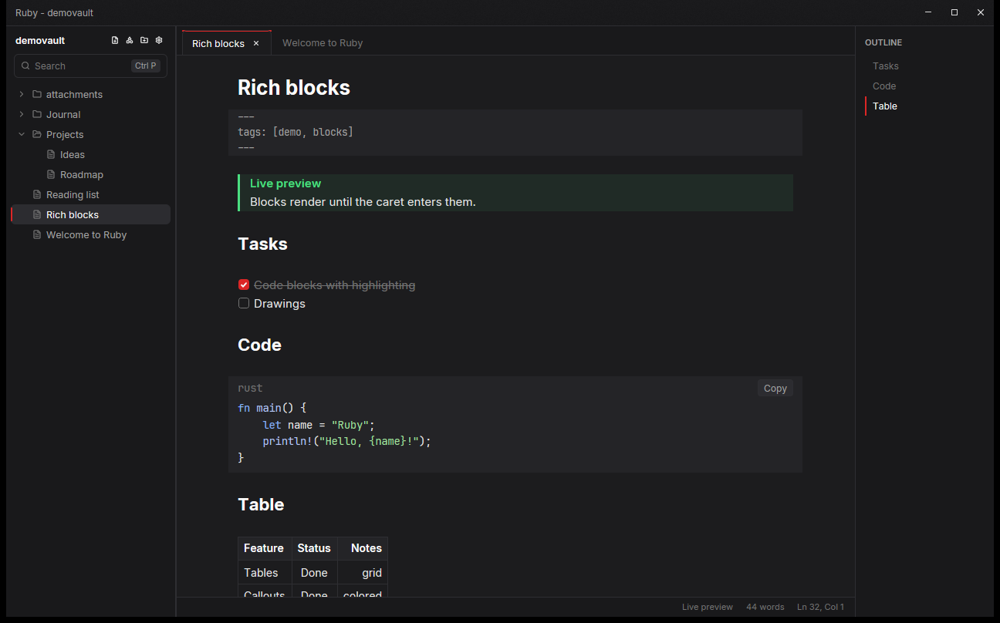

<p align="center">
	
</p>

<h1 align="center">Ruby</h1>

<p align="center">
	A fast, lightweight, native alternative to Obsidian.<br>
	Your notes stay plain Markdown files. The app stays out of your way.
</p>

<p align="center">
	<a href="../../releases/latest"><b>Download for Windows</b></a>
</p>



## Why Ruby

Obsidian is a great way to organize notes, but it runs on Electron: a full browser engine for a text editor. Ruby is written in Rust on top of [GPUI](https://www.gpui.rs/), the GPU-accelerated UI framework behind the Zed editor. No browser, no JavaScript runtime, no plugins loading in the background.

- **Light.** About 76 MB of memory with a 200-note vault and 5 notes open (release build, Windows 11). The executable is a single 25 MB file.
- **Fast.** Native rendering on the GPU. Startup is near instant.
- **Compatible.** A vault is just a folder of `.md` files. Open your existing Obsidian vault as is, and keep using both apps on it if you want.
- **Focused.** A pleasant Markdown editor and the features you actually use. No graph view, no plugin store.

## Features

Ruby is in early development. What works today:

- **Vault**: open any folder of Markdown notes; the last vault reopens on startup.
- **File tree**: create notes, drawings and folders, rename inline, move by drag and drop, delete to the Recycle Bin, reveal in Explorer.
- **Tabs**: open in the current tab or a new one, back and forward history per tab, reopen closed tabs, drag to reorder. Tabs, carets and scroll positions are restored on restart.
- **Live preview**: Markdown is rendered as you type (headings, bold, italic, strikethrough, `==highlights==`, inline code, links, `[[wikilinks]]`, quotes, lists, code blocks, rules). The raw syntax shows up only on the element under the caret, like Obsidian. `Ctrl+E` switches to the raw source mode.
- **Rich blocks**: syntax-highlighted code blocks with a copy button, tables drawn as grids (column alignment included), Obsidian callouts (`> [!tip]`), clickable task checkboxes, embedded images (`![[image.png|300]]`), and a compact frontmatter block. Click a block to edit its Markdown.
- **Images from the clipboard**: paste a screenshot with `Ctrl+V`; it is saved to the vault's `attachments` folder and embedded in the note.
- **Editor**: VS Code keyboard shortcuts, multi-cursor editing, undo and redo, line moves and copies, and full IME and accent support.
- **Markdown-aware typing**: Enter continues lists, numbered lists, tasks and quotes; Tab indents list items; `(`, `[` and backticks are paired automatically; pasting a URL over a selection makes a link.
- **Quick switcher and command palette**: `Ctrl+P` jumps to any file with fuzzy matching (`Shift+Enter` creates the note you typed); `Ctrl+Shift+P` lists every command with its shortcut.
- **Search**: `Ctrl+Shift+F` searches the whole vault as you type, off the UI thread, with results grouped by note. `Ctrl+F` and `Ctrl+H` find and replace in the current note. Both support case-sensitive and regular expression modes.
- **Links**: `Ctrl+click` follows a `[[wikilink]]`, a Markdown link or a URL, and creates the note if it does not exist yet. Typing `[[` suggests notes, drawings and images. Renaming or moving a file updates every link that points to it, in all notes.
- **Drawings**: a hand-drawn whiteboard compatible with the `.excalidraw` format (rectangles, diamonds, ellipses, arrows, lines, freehand, text, images), with selection, resize, rotate, groups, arrows that follow their shapes, undo, pan and zoom. A drawing opens in a tab like a note and is saved automatically.
- **Drawings in notes**: `![[drawing]]` alone on a line shows the drawing as a card. **Agrandir** opens it in a tab, **Editer** edits it in place (`Esc` or a click outside closes the editor). A note and a tab showing the same drawing stay in sync.
- **Settings**: text size, text width, default mode (live preview or source), folder for pasted images, language.
- **Inline title**: the note title above the text renames the file.
- **Outline**: the headings of the current note, click to jump.
- **Languages**: English and French. Ruby follows your system language, and you can change it in the settings.

### Your notes are safe

- Every save is atomic: the new content is written to a temporary file, flushed to disk, then swapped in. A crash never leaves a half-written note.
- Notes are saved automatically 500 ms after you stop typing, and immediately when you close a tab, switch away from the window or quit.
- Line endings (LF or CRLF) and UTF-8 byte order marks are preserved. A file you did not edit is never rewritten.
- If another app (Obsidian Sync, a text editor, a sync client) changes a note while you have unsaved edits, Ruby keeps your version and saves the other one next to it as `Note (conflict 2026-11-09 1430).md`. Nothing is silently dropped.
- If a note cannot be saved (read-only file, missing folder), Ruby keeps it open and asks before discarding your changes.

### Performance

Measured on a release build on Windows:

- Typing in a 10,000-line note: about 15 ms per keystroke (edit and layout).
- Memory with a 200-note vault and 5 tabs open: about 75 MB working set (about 117 MB when one of the tabs is a 10,000-line note).
- A drawing of 2,000 elements shown whole repaints in about 40 ms; the hand-drawn geometry of all 2,000 is computed in under 5 ms and then cached per element version.

## Keyboard shortcuts

| Action | Shortcut |
|---|---|
| Close tab | `Ctrl+W` |
| Next / previous tab | `Ctrl+Tab` / `Ctrl+Shift+Tab` |
| Reopen closed tab | `Ctrl+Shift+T` |
| Back / forward | `Alt+Left` / `Alt+Right` |
| Toggle file tree / outline | `Ctrl+Shift+E` / `Ctrl+Alt+B` |
| Settings | `Ctrl+,` |
| Go to file / command palette | `Ctrl+P` / `Ctrl+Shift+P` |
| Search in all notes | `Ctrl+Shift+F` |
| Find / replace in the note | `Ctrl+F` / `Ctrl+H` |
| Next / previous match | `Enter` / `Shift+Enter` in the find field, or `F3` / `Shift+F3` |
| Follow a link | `Ctrl+Click` |
| New note | `Ctrl+N` |
| Move by word | `Ctrl+Left` / `Ctrl+Right` |
| Delete word | `Ctrl+Backspace` / `Ctrl+Delete` |
| Copy / cut the whole line (no selection) | `Ctrl+C` / `Ctrl+X` |
| Select all | `Ctrl+A` |
| Undo / redo | `Ctrl+Z` / `Ctrl+Y` |
| Select next occurrence / all occurrences | `Ctrl+D` / `Ctrl+Shift+L` |
| Add a cursor (click / above / below) | `Alt+Click` / `Ctrl+Alt+Up` / `Ctrl+Alt+Down` |
| Move / copy lines | `Alt+Up/Down` / `Shift+Alt+Up/Down` |
| Delete line / select line | `Ctrl+Shift+K` / `Ctrl+L` |
| New line below / above | `Ctrl+Enter` / `Ctrl+Shift+Enter` |
| Indent / outdent | `Ctrl+]` / `Ctrl+[` (or `Tab` / `Shift+Tab` in lists) |
| Bold / italic / link | `Ctrl+B` / `Ctrl+I` / `Ctrl+K` |
| Live preview / source mode | `Ctrl+E` |

### Drawing shortcuts

| Action | Shortcut |
|---|---|
| Hand / select | `H` / `V` |
| Rectangle / diamond / ellipse | `R` / `D` / `O` |
| Arrow / line / pencil | `A` / `L` / `P` |
| Text / image / eraser | `T` / `I` / `E` |
| Pan | `Space` + drag, or the mouse wheel |
| Zoom / reset / fit | `Ctrl` + wheel / `Ctrl+0` / `Shift+1` |
| Select all | `Ctrl+A` |
| Move the selection | Arrow keys (`Shift`: 10 px) |
| Duplicate | `Ctrl+D` or `Alt` + drag |
| Group / ungroup | `Ctrl+G` / `Ctrl+Shift+G` |
| Copy / paste / delete | `Ctrl+C` / `Ctrl+V` / `Delete` |
| Undo / redo | `Ctrl+Z` / `Ctrl+Y` |

## Install

Download `Ruby-Setup-<version>.exe` from the [latest release](../../releases/latest) and run it.

- No administrator rights needed: Ruby installs for your user account in `%LOCALAPPDATA%\Programs\Ruby` (you can choose to install it for all users instead).
- It adds Ruby to the Start menu and, unless you uncheck it, a desktop shortcut.
- Installing a newer version over an existing one upgrades it in place.
- Uninstall it like any app from **Settings > Apps**. Your notes and your Ruby settings are left untouched.

Prefer no installer? Each release also has a portable `Ruby.exe`: put it anywhere and run it.

The files are not code-signed yet, so Windows SmartScreen may warn you the first time: click **More info**, then **Run anyway**. Each release ships a `SHA256SUMS.txt` file to check the downloads.

Ruby keeps its own settings in `%APPDATA%\Ruby` (last vault, language, open tabs). Your vault folder is never touched for that.

## Build from source

Requirements: Windows 10 or 11, [Rust](https://rustup.rs/) 1.98 or newer, and the MSVC build tools.

```powershell
git clone <repository url> ruby
cd ruby
cargo build --release -p ruby
.\target\release\Ruby.exe
```

Run the tests with `cargo test --workspace`.

The code is split in two crates:

- `crates/core` (`ruby-core`): file formats, saving, vault scan, file operations, the editing model. Plain Rust, no UI, fully unit tested.
- `crates/app` (`ruby`): the GPUI application.

## Releases

Every merge into `main` runs the tests, builds `Ruby.exe` and its installer, and publishes both as a new GitHub release named after the version in `crates/app/Cargo.toml` and the build number (for example `v0.1.0-build.12`).

The installer is made with [Inno Setup](https://jrsoftware.org/isinfo.php) from `installer/ruby.iss`. To build it locally after a release build: `ISCC.exe /DAppVersion=0.1.0 installer\ruby.iss` (output in `dist\`).

## Credits

- [GPUI](https://www.gpui.rs/) by Zed Industries and [GPUI Kit](https://gpui-kit.com/) by Longbridge (Apache-2.0).
- [Inter](https://rsms.me/inter/) and [JetBrains Mono](https://www.jetbrains.com/lp/mono/) fonts (SIL Open Font License).
- [Kalam](https://fonts.google.com/specimen/Kalam) hand-drawn font (SIL Open Font License).
- [Lucide](https://lucide.dev/) icons (ISC).

Ruby is an independent project and is not affiliated with Obsidian.

## License

Ruby is open source under the [MIT License](LICENSE).
